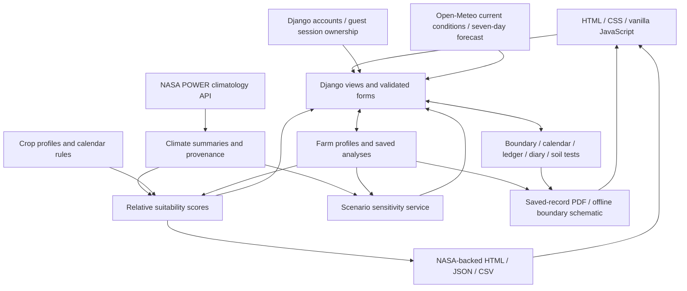

# Architecture and methodology

AgriTwin AI uses a single Django project with eleven apps. The browser receives HTML pages and static CSS/JavaScript. Python services perform data processing and recommendation calculations; there is no separate frontend development server. SQLite stores account, farm, and management records; diary photos use private local file storage.



## App boundaries

| App | Owns |
| --- | --- |
| `core` | Public landing page, information page, health endpoint, shared presentation context |
| `accounts` | Django registration, sign-in/out, password changes, safe redirects, guest-farm claims |
| `farms` | `Farm` and saved `Analysis` records, farm forms, centralized account/guest ownership checks |
| `boundaries` | One GeoJSON polygon per farm, geometry validation, WGS84 area/perimeter, map editing and schematic output |
| `notebook` | `CalendarEvent`, `LedgerEntry`, `DiaryEntry`, `SoilTest`, private photo serving, and record summaries |
| `weather` | Open-Meteo requests, weather validation, 15-minute cache, bilingual forecast presentation |
| `climate` | NASA requests, response validation, provenance, monthly and seasonal aggregation |
| `rotations` | Crop knowledge data, candidate generation, calendar checks, score explanations |
| `simulator` | Scenario input validation and comparisons against one shared baseline |
| `reports` | A NASA-backed analysis report and JSON/CSV downloads, plus a network-free saved-record PDF export |
| `chatbot` | Session-private conversations, local farming guidance with crop/topic follow-ups, and minimized saved farm/NASA context; no external AI service |

Views coordinate these services. Templates display results and uncertainties; they do not implement crop-scoring logic. Browser scripts enhance presentation and controls without replacing server-side validation.

## Stored data and ownership

`Farm` stores the user-entered location and management choices. Its nullable account owner distinguishes registered users' farms from guest farms identified by `owner_session`. `Analysis` stores the climate response and evaluated strategies associated with a farm. A farm has one optional `FarmBoundary` and many calendar, ledger, diary, and soil-test records. Deleting a farm cascades to those records. SQLite persists the database locally; diary photo bytes live in `MEDIA_ROOT`.

Every farm-specific route uses the centralized ownership queryset. Authenticated requests see only farms owned by that account; guest requests see only unowned farms matching their browser session. Record IDs are also scoped to the authorized farm. These checks cover maps, reports, record mutations, and private photo streams, so guessing an ID cannot grant access. Admin uses Django's staff authentication separately.

Registration and sign-in capture the guest session key before Django rotates it, and claim only unowned farms tied to that key. Account ownership then works across devices connecting to the same server/database. There is no database synchronization between independent local installations and no hosted deployment included. Guest farms still depend on retaining their browser session until claimed. Password handling and validation use Django auth; password changes are available, while email recovery and SMTP are not configured.

Saving an edited farm invalidates its previous analysis so results cannot silently continue describing an outdated profile. Refreshing climate data replaces the analysis with a newly sourced comparison. Reports disclose the source and analysis time.

## Farm boundaries and management records

The boundary editor progressively enhances a normal GeoJSON form with a bundled Leaflet map. Coordinates are longitude/latitude pairs in a single closed ring without holes, limited to 3–500 distinct corners inside the Bangladesh planning envelope. Server validation rejects malformed, nonfinite, self-intersecting, or degenerate geometry. GeographicLib computes geodesic area and perimeter on WGS84. These are estimates from the supplied corners, not cadastral measurements. The farmer may explicitly copy estimated acreage to the profile; removing the boundary preserves that saved acreage. The renderer can create a north-up schematic without external tiles, including in PDFs.

Calendar events store task type, crop/field, planned date, reminder lead time, notes, and completion. Reminder lists are derived at request time using Asia/Dhaka's current date. Due and overdue tasks remain visible until completed. Reminders are inside the app only; there is no scheduled email, SMS, push, or background notification service.

Ledger entries store positive BDT decimal amounts with income/expense type, date, category, and notes. Aggregations compute recorded income minus recorded expenses across all dates. This actual transaction record is independent of the rotation engine's economic heuristic and does not estimate missing costs or future sales.

Diary entries contain a date, title, notes, optional photo, and caption. Upload forms decode and verify JPEG/PNG images, enforce 5 MB and 20-megapixel limits, and re-encode accepted pixels as PNG to remove unrelated file content and metadata. Photo streams resolve farm ownership and send private, no-store, nosniff responses. The project does not mount a public media directory. Replacement/removal and cascade deletion clean up the old file after a successful database commit. Backups need both the database and `MEDIA_ROOT` (`media/` by default).

Soil tests store date, laboratory/source, optional pH and N-P-K values, and method/sample notes. pH is constrained to 0–14, nutrients are nonnegative mg/kg, and at least one measurement is required. Unknown values are null, distinct from a measured zero. Each comparison uses the latest two non-null records for that metric and shows their dates. History never silently updates farm profile pH or recalculates crop scores; farmers can edit the profile when they want a new result used for planning. Laboratory method and sampling comparability remain the user's responsibility.

## Current weather and forecasts

Open-Meteo supplies current model conditions and seven daily forecasts independently from NASA climatology. The fixed HTTPS endpoint receives farm coordinates and requests explicit units and Asia/Dhaka time. Validation checks required variables, numeric ranges, unit labels, timestamp freshness, and consecutive forecast dates. A weather response never changes `Analysis` or its scores.

Successful weather results use Django's cache for up to 15 minutes, with keys scoped to coordinates and the local date. Refresh bypasses that cache. Requests use bounded connect/read timeouts; failures and malformed responses produce an unavailable page rather than invented forecasts. The page identifies its source and retrieval time. Access requires internet and provider availability; review Open-Meteo's current terms and usage limits for the intended deployment. There is no API key configured for the public endpoint.

## Climate processing

The POWER client requests a fixed, allowlisted external endpoint with bounded network timeouts. Coordinates are validated by forms before retrieval. Valid monthly observations are normalized into a 12-month series; missing-value sentinels, malformed payloads, and inconsistent units must not become climate observations.

Precipitation rates are converted using declared units and month length. The service must not guess whether a value is a rate or total from its magnitude. Monthly temperatures are climatological means of their respective variables, so a high monthly maximum-temperature mean is a screening indicator, not an observed count of heatwave days.

The climate result carries `status`, `source`, provenance, `raw_response`, `monthly_data`, `annual_summary`, and soil-moisture disclosure. The original NASA response is stored with the farm analysis and can be downloaded separately. The source URL, climatological period, parameter units, and retrieval time remain visible through dashboards and reports.

NASA data is required. Retrieval or validation failures raise a service exception rather than supplying sample values. Farm details remain saved, but routes that need a baseline return an unavailable response until valid NASA data exists. A failed refresh preserves a prior valid NASA snapshot. Legacy synthetic analyses cannot be reused as a baseline. The example farm follows the same NASA retrieval path as any other farm.

## Rotation comparisons

The three candidates are the farmer's current crop sequence, an Aman–lentil sequence, and an Aman–mustard–mung bean sequence. Current crops affect the baseline instead of being collected and ignored.

Each candidate reports water, climate, soil, and economic component scores on a relative 0–100 scale. The weighted sum produces a comparison score:

```text
S = w_water × water + w_climate × climate
  + w_soil × soil + w_economic × economic
```

Weights sum to one and vary by farmer priority. The returned result exposes the weights and component values, together with the rules' benefits, risks, and uncertainties. Input values such as farm area do not turn the qualitative economic proxy into a cash-flow prediction.

| Priority | Water | Climate | Soil | Economic |
| --- | ---: | ---: | ---: | ---: |
| Conserve water | 0.45 | 0.25 | 0.15 | 0.15 |
| Improve soil health | 0.20 | 0.20 | 0.40 | 0.20 |
| Explore economic potential | 0.20 | 0.20 | 0.15 | 0.45 |
| Build climate resilience | 0.30 | 0.35 | 0.20 | 0.15 |

The water component estimates an indicator of unmet demand from profile water demand, 65% of rain during scheduled growing periods, and assumed annual irrigation allowances of 100, 450, or 900 mm for limited, moderate, or abundant access. These coefficients are uncalibrated prototype assumptions. They are not a water balance, measured water savings, or an irrigation prescription.

The climate component begins at 90 and reduces the score when growing-period mean temperature exceeds prototype crop thresholds. Soil scoring combines profile scores with qualitative legume and diversity bonuses. Economic scoring averages profile scores, with low-budget penalties for Boro rice and three-crop management. No component is fitted against a field outcome dataset.

Calendar validation considers seasonal planting and harvest windows, crop durations, ordering, and turnaround. Summing crop durations and checking that they are below 365 days is insufficient: two crops can still need the same planting window. Infeasible sequences are identified explicitly and must not outrank feasible options merely because their component scores are high.

Soil pH remains unknown when the farmer leaves it blank. Poor drainage blocks pulse/oilseed scenarios; unknown drainage adds an uncertainty. Intensive dry-season Boro is not eligible under limited irrigation, although the current baseline remains visible with its score and reasons. Incompatible known soil textures or pH, unsupported geography, and infeasible calendars also gate eligibility. A crop profile's biological nitrogen potential is a qualitative contribution, not a measured fertilizer replacement amount for the farm.

## Scenario simulation

The simulator copies one saved baseline and perturbs monthly rainfall and temperature. It then evaluates the same candidates using the selected irrigation and priority settings. Baseline and scenario comparisons use the same underlying climate snapshot, avoiding network changes being mistaken for scenario effects.

Each candidate returns its baseline score, changed score, difference, and explanation. A zero-change scenario should reproduce the baseline when management inputs are also unchanged. The service does not claim a calibrated soil-water balance or biological crop growth model, and it does not issue a weather forecast.

Rainfall can change by −50% to +50%, and temperature by −1°C to +5°C. Regional root-zone wetness is held at its baseline value; the simulator does not infer a new soil-moisture measurement from a rainfall slider.

## Reports and verification

The printable HTML analysis report and JSON/CSV downloads use the NASA-backed analysis shown by the UI. They include farm inputs, NASA provenance, strategies, caveats, and calculation time, and require a valid NASA baseline. The original NASA response has a separate JSON download.

The server-side PDF exporter reads saved farm details, the boundary, management records, and any validated saved NASA analysis. It makes no NASA, weather, tile, or other network request while exporting. ReportLab draws a north-up boundary schematic and lays out the profile, analysis, calendar/reminder settings, BDT ledger, soil tests, and diary text/photo captions. Photo image files remain in the private diary. Bundled Noto fonts and HarfBuzz provide Bangla text shaping. Without a valid saved NASA analysis, the PDF explicitly omits climate values and crop scores and still exports the saved records. Ownership is checked before serving the private attachment. Browser printing remains available for the HTML analysis report.

Automated checks exercise account/guest ownership, cross-device access, invalid record forms, boundary geometry, reminder windows, decimal finance totals, photo validation/privacy/cleanup, soil changes, bilingual presentation, mocked weather and NASA success/failure, precipitation conversion, calendar conflicts, scoring behavior, simulation consistency, and report exports. These verify implementation behavior. Local agronomic review and comparison with field measurements would be separate validation work.
