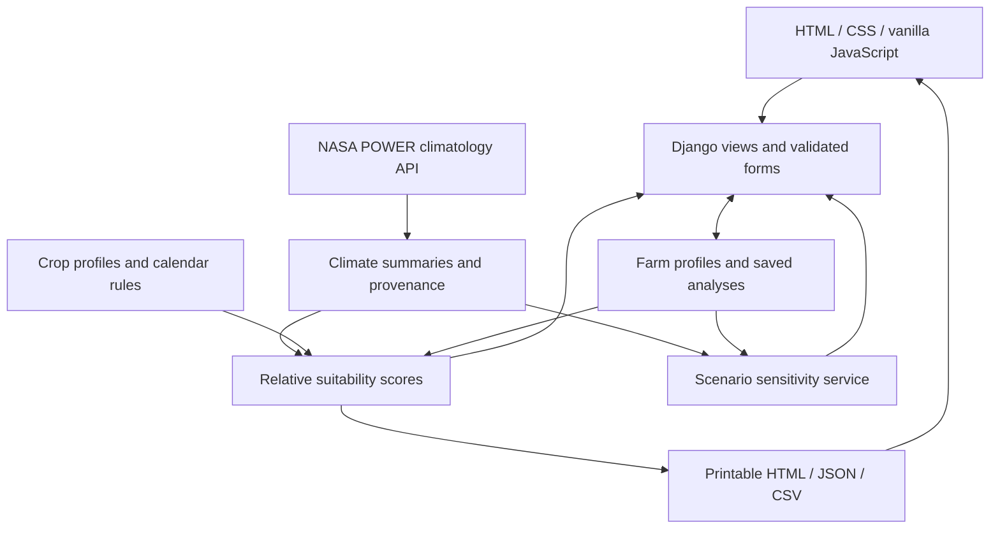

# Architecture and methodology

AgriTwin AI uses a single Django project with seven apps. The browser receives HTML pages and static CSS/JavaScript. Python services perform data processing and recommendation calculations; there is no separate frontend development server.



## App boundaries

| App | Owns |
| --- | --- |
| `core` | Public landing page, information page, health endpoint, shared presentation context |
| `farms` | `Farm` and saved `Analysis` records, farm forms, session-based ownership |
| `climate` | NASA requests, response validation, provenance, monthly and seasonal aggregation |
| `rotations` | Crop knowledge data, candidate generation, calendar checks, score explanations |
| `simulator` | Scenario input validation and comparisons against one shared baseline |
| `reports` | A readable analysis report and structured downloads |
| `chatbot` | Session-private conversations, local farming guidance with crop/topic follow-ups, and minimized saved farm/NASA context; no external AI service |

Views coordinate these services. Templates display results and uncertainties; they do not implement crop-scoring logic. Browser scripts enhance presentation and controls without replacing server-side validation.

## Stored data and ownership

`Farm` stores the user-entered location and management choices. `Analysis` stores the climate response and evaluated strategies associated with that farm. SQLite persists those records locally.

Farm access is restricted to the creating browser session. Every farm-specific route resolves the farm using both its primary key and the requesting session's ownership value. Predicting another record's integer ID must not grant access. Admin access uses Django's staff authentication separately.

This is a session-based prototype, without farmer registration or cross-device recovery. Losing the session cookie can make a profile inaccessible from the ordinary UI. Staff can inspect stored records through admin. A production account system would need an explicit ownership migration rather than simply exposing records globally.

Saving an edited farm invalidates its previous analysis so results cannot silently continue describing an outdated profile. Refreshing climate data replaces the analysis with a newly sourced comparison. Reports disclose the source and analysis time.

## Climate processing

The POWER client requests a fixed, allowlisted external endpoint with bounded network timeouts. Coordinates are validated by forms before retrieval. Valid monthly observations are normalized into a 12-month series; missing-value sentinels, malformed payloads, and inconsistent units must not become climate observations.

Precipitation rates are converted using declared units and month length. The service must not guess whether a value is a rate or total from its magnitude. Monthly temperatures are climatological means of their respective variables, so a high monthly maximum-temperature mean is a screening indicator, not an observed count of heatwave days.

The climate result carries `status`, `source`, provenance, `raw_response`, `monthly_data`, `annual_summary`, and soil-moisture disclosure. The original NASA response is stored with the farm analysis and can be downloaded separately. The source URL, climatological period, parameter units, and retrieval time remain visible through dashboards and reports.

NASA data is required. Retrieval or validation failures raise a service exception rather than supplying sample values. Farm details remain saved, but routes that need a baseline return an unavailable response until valid NASA data exists. A failed refresh preserves a prior valid NASA snapshot. Legacy synthetic analyses cannot be reused as a baseline. The example farm follows the same NASA retrieval path as any other farm.

## Rotation comparisons

The three candidates are the farmer's current crop sequence, an Aman–lentil sequence, and an Aman–mustard–mung bean sequence. Current crops affect the baseline instead of being collected and ignored.

Each candidate reports water, climate, soil, and economic component scores on a relative 0–100 scale. The weighted sum produces a comparison score:

```text
S = w_water × water + w_climate × climate
  + w_soil × soil + w_economic × economic
```

Weights sum to one and vary by farmer priority. The returned result exposes the weights and component values, together with the rules' benefits, risks, and uncertainties. Input values such as farm area do not turn the qualitative economic proxy into a cash-flow prediction.

| Priority | Water | Climate | Soil | Economic |
| --- | ---: | ---: | ---: | ---: |
| Conserve water | 0.45 | 0.25 | 0.15 | 0.15 |
| Improve soil health | 0.20 | 0.20 | 0.40 | 0.20 |
| Explore economic potential | 0.20 | 0.20 | 0.15 | 0.45 |
| Build climate resilience | 0.30 | 0.35 | 0.20 | 0.15 |

The water component estimates an indicator of unmet demand from profile water demand, 65% of rain during scheduled growing periods, and assumed annual irrigation allowances of 100, 450, or 900 mm for limited, moderate, or abundant access. These coefficients are uncalibrated prototype assumptions. They are not a water balance, measured water savings, or an irrigation prescription.

The climate component begins at 90 and reduces the score when growing-period mean temperature exceeds prototype crop thresholds. Soil scoring combines profile scores with qualitative legume and diversity bonuses. Economic scoring averages profile scores, with low-budget penalties for Boro rice and three-crop management. No component is fitted against a field outcome dataset.

Calendar validation considers seasonal planting and harvest windows, crop durations, ordering, and turnaround. Summing crop durations and checking that they are below 365 days is insufficient: two crops can still need the same planting window. Infeasible sequences are identified explicitly and must not outrank feasible options merely because their component scores are high.

Soil pH remains unknown when the farmer leaves it blank. Poor drainage blocks pulse/oilseed scenarios; unknown drainage adds an uncertainty. Intensive dry-season Boro is not eligible under limited irrigation, although the current baseline remains visible with its score and reasons. Incompatible known soil textures or pH, unsupported geography, and infeasible calendars also gate eligibility. A crop profile's biological nitrogen potential is a qualitative contribution, not a measured fertilizer replacement amount for the farm.

## Scenario simulation

The simulator copies one saved baseline and perturbs monthly rainfall and temperature. It then evaluates the same candidates using the selected irrigation and priority settings. Baseline and scenario comparisons use the same underlying climate snapshot, avoiding network changes being mistaken for scenario effects.

Each candidate returns its baseline score, changed score, difference, and explanation. A zero-change scenario should reproduce the baseline when management inputs are also unchanged. The service does not claim a calibrated soil-water balance or biological crop growth model, and it does not issue a weather forecast.

Rainfall can change by −50% to +50%, and temperature by −1°C to +5°C. Regional root-zone wetness is held at its baseline value; the simulator does not infer a new soil-moisture measurement from a rainfall slider.

## Reports and verification

Printable reports and JSON/CSV downloads are generated from the NASA-backed analysis used by the UI. They include farm inputs, NASA provenance, strategies, caveats, and calculation time. The original NASA response has a separate JSON download. Reports are unavailable when no valid NASA baseline exists. Browser printing supports PDF through the user's print dialog; there is no server-side PDF engine.

Automated checks exercise invalid forms, ownership boundaries, mocked NASA success/failure, precipitation conversion, calendar conflicts, scoring behavior, simulation consistency, and report exports. These verify implementation behavior. Local agronomic review and comparison with field measurements would be separate validation work.
